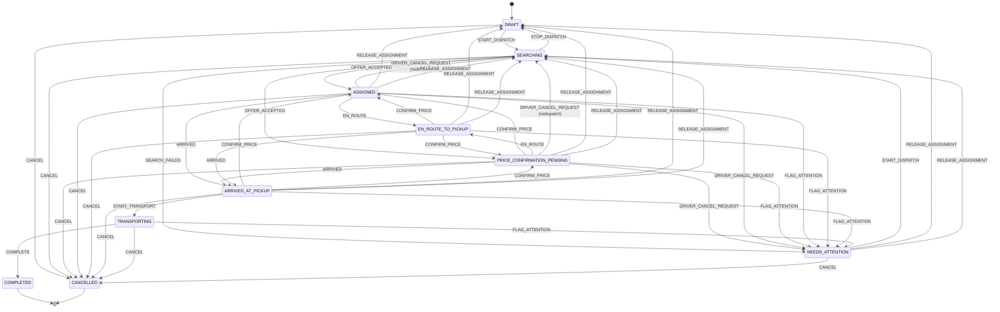

# Live dispatch — 02. Պատվերի և առաջարկի վիճակներ

> Գեներացված է `backend/scripts/print-state-machine.ts`-ով `ORDER_TRANSITIONS`-ից (`backend/src/live-dispatch/orders/domain/order-state.ts`)։ Ձեռքով մի խմբագրեք․ փոխեք կոդը և վերագեներացրեք։ Բոլոր անցումները ստուգվում են backend-ում՝ պատվերի տողի lock-ի տակ։

## Պատվերի վիճակներ

`DRAFT` · `SEARCHING` · `PRICE_CONFIRMATION_PENDING` · `ASSIGNED` · `EN_ROUTE_TO_PICKUP` · `ARRIVED_AT_PICKUP` · `TRANSPORTING` · `COMPLETED` · `NEEDS_ATTENTION` · `CANCELLED`

## Թույլատրված անցումներ

| Գործողություն | Որտեղից | Ուր | Ով | Նախապայմաններ |
| --- | --- | --- | --- | --- |
| `START_DISPATCH` | `DRAFT`, `NEEDS_ATTENTION` | SEARCHING | ADMIN | requirements confirmed or overridden; FIXED needs a price; from NEEDS_ATTENTION only for a failed SEARCH (no driver attached) |
| `STOP_DISPATCH` | `SEARCHING` | DRAFT | ADMIN | pending offer is revoked in the same transaction |
| `OFFER_ACCEPTED` | `SEARCHING` | ASSIGNED (FIXED) \| PRICE_CONFIRMATION_PENDING (NEGOTIATION_REQUIRED) | DRIVER | offer PENDING, before deadline (DB clock), terms version current, order and driver have no active assignment |
| `SEARCH_FAILED` | `SEARCHING` | NEEDS_ATTENTION | SYSTEM | candidates exhausted, attempt limit or max duration reached, no pending offer |
| `CONFIRM_PRICE` | `PRICE_CONFIRMATION_PENDING`, `EN_ROUTE_TO_PICKUP`, `ARRIVED_AT_PICKUP` | ASSIGNED from PRICE_CONFIRMATION_PENDING, otherwise unchanged | ADMIN, DRIVER | NEGOTIATION_REQUIRED and not yet confirmed; agreed price ≥ 0; a driver only on their own order (he agrees it with the customer by phone — 2026-11) |
| `EN_ROUTE` | `ASSIGNED`, `PRICE_CONFIRMATION_PENDING` | EN_ROUTE_TO_PICKUP | DRIVER, ADMIN | driver may head out while the price is being agreed |
| `ARRIVED` | `ASSIGNED`, `PRICE_CONFIRMATION_PENDING`, `EN_ROUTE_TO_PICKUP` | ARRIVED_AT_PICKUP | DRIVER, ADMIN | — |
| `START_TRANSPORT` | `ARRIVED_AT_PICKUP` | TRANSPORTING | DRIVER, ADMIN | price FIXED or confirmed (PRICE_NOT_CONFIRMED otherwise) |
| `COMPLETE` | `TRANSPORTING` | COMPLETED | DRIVER, ADMIN | ends the assignment; does NOT change payment status |
| `DRIVER_CANCEL_REQUEST` | `PRICE_CONFIRMATION_PENDING`, `ASSIGNED` | SEARCHING (redispatch) or NEEDS_ATTENTION (DRIVER_CANCEL_REQUEST) | DRIVER | not yet EN_ROUTE (2026-11 — once en route a driver can only report a PROBLEM). Reason other than CUSTOMER_DECLINED (incl. NOT_SPECIFIED, sent when the driver picks none in 45 s) and the pickup has coordinates → the driver is released and a new automatic search starts without him (nor anyone who already rejected the order), same transaction. CUSTOMER_DECLINED → assignment KEPT until an operator decides |
| `FLAG_ATTENTION` | `PRICE_CONFIRMATION_PENDING`, `ASSIGNED`, `EN_ROUTE_TO_PICKUP`, `ARRIVED_AT_PICKUP`, `TRANSPORTING` | NEEDS_ATTENTION (OPERATOR_FLAG \| DRIVER_PROBLEM) | ADMIN | assignment is kept |
| `RESUME_FROM_ATTENTION` | `NEEDS_ATTENTION` | statusBeforeAttention | ADMIN | only when a driver is still attached; open driver request is resolved |
| `RELEASE_ASSIGNMENT` | `NEEDS_ATTENTION`, `PRICE_CONFIRMATION_PENDING`, `ASSIGNED`, `EN_ROUTE_TO_PICKUP`, `ARRIVED_AT_PICKUP` | DRAFT, or SEARCHING when restartSearch=true | ADMIN | explicit operator confirmation; ends the assignment, resolves the open request; one transaction |
| `CANCEL` | `DRAFT`, `SEARCHING`, `PRICE_CONFIRMATION_PENDING`, `ASSIGNED`, `EN_ROUTE_TO_PICKUP`, `ARRIVED_AT_PICKUP`, `TRANSPORTING`, `NEEDS_ATTENTION` | CANCELLED | ADMIN | reason required (comment when OTHER); revokes pending offer, ends assignment |

## Առաջարկի վիճակներ (առանձին մեքենա)

| Անցում | Ով/ինչ | Պայման |
| --- | --- | --- |
| `PENDING → ACCEPTED` | DRIVER | `now() < expiresAt` (DB ժամացույց), terms version-ը ընթացիկ է, պատվերը SEARCHING է, ոչ պատվերը, ոչ վարորդը ակտիվ assignment չունեն — մեկ transaction-ում assignment-ի հետ |
| `PENDING → REJECTED` | DRIVER | deadline-ից առաջ, հակառակ դեպքում՝ EXPIRED |
| `PENDING → EXPIRED` | SYSTEM (expiry job, reconciler) կամ ուշացած accept/reject | միայն եթե `now() >= expiresAt`; կրկնվող job-ը no-op է |
| `PENDING → REVOKED` | ADMIN (stop, cancel, պայմանների փոփոխություն) | `closeReason` = DISPATCH_STOPPED / ORDER_CANCELLED / TERMS_CHANGED |

Ոչ մի վիճակ PENDING-ից բացի չի փոխվում։ Reservation-ը PENDING offer-ն է՝ `OrderOffer_one_pending_per_driver` index-ով։

## NEEDS_ATTENTION-ի երկու իմաստ

| `attentionKind` | Վարորդ կցված է՞ | Ինչ կարող է անել օպերատորը |
| --- | --- | --- |
| `SEARCH_EXHAUSTED`, `SEARCH_TIMEOUT`, `MANUAL_OFFER_FAILED` | Ոչ | `START_DISPATCH` (նոր որոնում), manual offer, `CANCEL` |
| `DRIVER_CANCEL_REQUEST`, `DRIVER_PROBLEM`, `OPERATOR_FLAG` | **Այո — assignment-ը պահպանվում է** | `RESUME_FROM_ATTENTION` (վարորդը մնում է), `RELEASE_ASSIGNMENT` (+ ըստ ցանկության նոր որոնում նույն transaction-ում), `CANCEL` |
